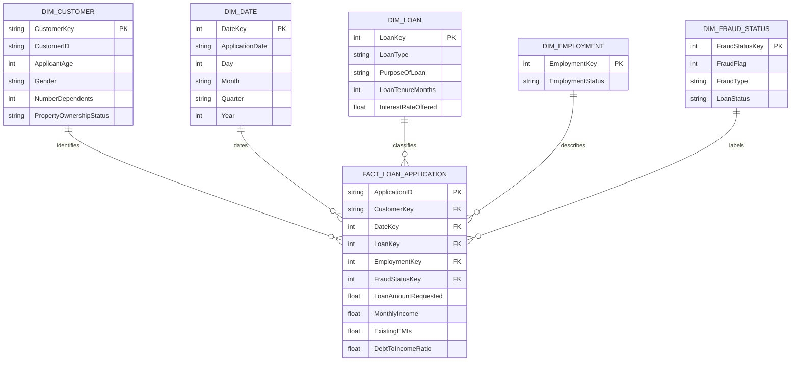

# Data Warehouse and Data Mart Design

## Source and staging

The source is the 5,000-row SheetDB JSON dataset at `https://sheetdb.io/api/v1/jnveyifpbrsuy`. `ml/train.py` downloads it to `data/cleaned_dataset.csv`, removes duplicate rows, coerces numeric fields, derives missing DTI values from EMI and income, and validates `FraudFlag`.

## Star schema

The analytical grain is one row per loan application.

## Fact table

`FACT_LOAN_APPLICATION` stores measures and foreign keys at application grain:

- `ApplicationID` primary key
- `CustomerKey`, `DateKey`, `LoanKey`, `EmploymentKey`, `FraudStatusKey` foreign keys
- Measures: requested amount, monthly income, existing EMIs, DTI, tenure, interest rate, and the binary fraud label

## Dimensions

- `DIM_CUSTOMER`: customer identifier and demographic/ownership attributes.
- `DIM_DATE`: application date, day, month, quarter, and year for time analysis.
- `DIM_LOAN`: loan type, purpose, tenure, and offered interest rate.
- `DIM_EMPLOYMENT`: employment category.
- `DIM_FRAUD_STATUS`: fraud flag, fraud type, and observed loan status.

The current repository implements this model as a documented analytical design over the cleaned CSV rather than pretending that a relational database has already been deployed. FastAPI exposes the equivalent aggregate queries; a PostgreSQL implementation can materialize these dimensions without changing the frontend contract.

## OLAP operations demonstrated by the UI

- **Roll-up:** application age is grouped into 18-25, 26-35, 36-45, 46-55, and 56+.
- **Drill-down:** overall fraud rate is broken down by loan type and employment status, then to individual records in Dataset.
- **Slice:** the Dataset page's fraud or loan-type filter isolates one dimension value.
- **Dice:** combining fraud status, loan type, employment, and search terms selects a multi-dimensional subset.
